# LibreApp — Biblioteca virtual

**Estudiante:** Sneider Isaac Pérez Rodríguez
**Proyecto:** Actividad de producto — configuración, profesionalización y puesta en producción de una aplicación Laravel
**Sitio en producción:** [https://libre.boats](https://libre.boats)
**Repositorio:** [github.com/Srlsaac/Desempe-o-Libreria-](https://github.com/Srlsaac/Desempe-o-Libreria-)

## Descripción

LibreApp es una aplicación web para gestionar el catálogo de una biblioteca y los préstamos de libros.

- Los **visitantes** consultan el catálogo, buscan por título o autor y ven la disponibilidad de cada libro.
- Los **lectores** se registran, solicitan préstamos y ven su historial con las fechas de vencimiento.
- El **administrador** gestiona libros, autores y categorías, aprueba o rechaza solicitudes, registra devoluciones y ve los préstamos vencidos.

En esta etapa del proyecto la aplicación se llevó a un entorno de producción real: correo transaccional, monitoreo de disponibilidad, almacenamiento externo de archivos, seguimiento de errores, política de privacidad y eliminación de cuentas.

## Tecnologías y servicios

| Capa | Tecnología |
|---|---|
| Backend | Laravel 13 y PHP 8.4 |
| Autenticación | Laravel Breeze |
| Interfaz | Blade y Bootstrap 5 |
| Base de datos | MySQL en local y PostgreSQL en producción |
| Despliegue | Docker en Render |
| Dominio | libre.boats (Namecheap), con certificado HTTPS de Render |
| Correo transaccional | Resend |
| Monitoreo de disponibilidad | Better Stack (Uptime) |
| Almacenamiento externo | Backblaze B2 (compatible con S3) |
| Seguimiento de errores | Sentry |

## Funcionalidades

### Zona pública
- Catálogo con búsqueda por título o autor y paginación.
- Detalle del libro con portada y copias disponibles.
- Registro, inicio de sesión y recuperación de contraseña por correo.
- Política de tratamiento de datos personales.

### Zona del lector
- Solicitar un préstamo desde el detalle del libro.
- Ver mis préstamos con estado, fecha de préstamo, vencimiento y devolución.
- Consultar la constancia de autorización de datos y eliminar la cuenta desde Mi perfil.

### Zona del administrador
- CRUD de libros (con portada), autores y categorías.
- Aprobar o rechazar solicitudes y marcar devoluciones.
- Alerta y filtro de préstamos vencidos.

## Reglas de negocio

- No se puede solicitar un libro sin copias disponibles.
- Al aprobar un préstamo se descuenta una copia; al devolverlo, se suma.
- El préstamo vence a los **15 días** de ser aprobado.
- Cada lector puede tener como máximo **3 préstamos en curso** (pendientes y activos).
- No se puede eliminar una categoría, un autor o un libro con registros asociados.
- La aprobación y la devolución usan transacciones (`DB::transaction`) y bloqueo de fila (`lockForUpdate`).

## Modelo de datos

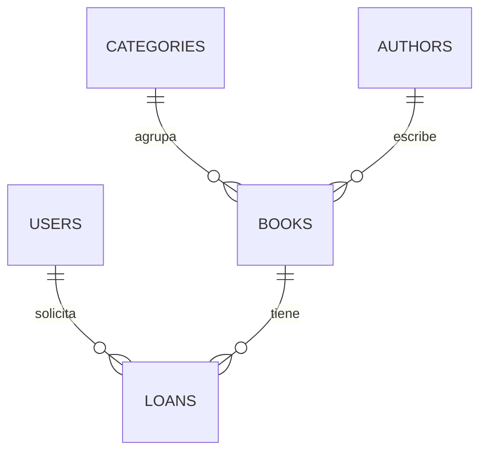

| Tabla | Campos principales | Relaciones |
|---|---|---|
| `users` | name, email, password, role (`admin` o `reader`), documento, telefono, constancia de autorización de datos | Tiene muchos `loans` |
| `categories` | name, slug, description | Tiene muchos `books` |
| `authors` | name, nationality, bio | Tiene muchos `books` |
| `books` | title, isbn, description, year, copies_total, copies_available, cover_image, active | Pertenece a una `category` y a un `author`; tiene muchos `loans` |
| `loans` | status, loan_date, due_date, return_date, notes | Pertenece a un `book` y a un `user` |

Estados de un préstamo: `pending`, `active`, `returned`, `overdue` y `rejected`.

## Rutas principales

| Ruta | Acceso | Descripción |
|---|---|---|
| `/` | Público | Página de inicio |
| `/catalogo` | Público | Catálogo con búsqueda |
| `/privacidad` | Público | Política de tratamiento de datos personales |
| `/login`, `/register`, `/forgot-password` | Público | Autenticación y recuperación de contraseña |
| `/mis-prestamos` | Lector | Mis préstamos |
| `/admin/loans` | Administrador | Gestión de préstamos |
| `/admin/books` | Administrador | CRUD de libros |
| `/admin/authors` | Administrador | CRUD de autores |
| `/admin/categories` | Administrador | CRUD de categorías |
| `/admin/sentry-test` | Administrador | Lanza un error de prueba para verificar Sentry |

Las rutas `/admin` están protegidas con el middleware `admin`. Un usuario que no sea administrador recibe un error 403.

## Instalación en local

Requisitos: PHP 8.3 o superior, Composer, Node.js y MySQL.

```bash
git clone https://github.com/Srlsaac/Desempe-o-Libreria-.git libreapp
cd libreapp
composer install
```

Copia el archivo de entorno (en Windows: `copy .env.example .env`) y genera la clave:

```bash
cp .env.example .env
php artisan key:generate
```

Crea una base de datos vacía llamada `libreapp` y ajusta estas líneas en el `.env`:

```
DB_CONNECTION=mysql
DB_HOST=127.0.0.1
DB_PORT=3306
DB_DATABASE=libreapp
DB_USERNAME=root
DB_PASSWORD=
```

Después ejecuta:

```bash
php artisan migrate --seed
php artisan storage:link
npm install
npm run build
php artisan serve
```

Abre [http://127.0.0.1:8000](http://127.0.0.1:8000).

El `.env.example` viene con `FILESYSTEM_DISK=public` y `MAIL_MAILER=log`, así que el proyecto corre en local sin cuentas de Backblaze ni de Resend: las portadas se guardan en el disco local y los correos se escriben en `storage/logs`.

## Usuario administrador

El seeder crea este usuario:

| Correo | Contraseña |
|---|---|
| `admin@libreapp.com` | `password` |

Los lectores se registran desde `/register` y quedan con el rol `reader`.

## Variables de entorno

Ninguna credencial está en el repositorio. Todas se definen en el `.env` local (excluido de Git) y en el panel **Environment** de Render. El archivo `.env.example` solo trae los nombres, con los valores vacíos.

| Variable | Para qué sirve |
|---|---|
| `APP_NAME`, `APP_ENV`, `APP_KEY`, `APP_DEBUG`, `APP_URL`, `APP_LOCALE` | Configuración general de Laravel |
| `LOG_CHANNEL` | Canal de logs (`stderr` en producción, para verlos en Render) |
| `DB_CONNECTION`, `DB_URL` | Base de datos de producción (PostgreSQL) |
| `DB_HOST`, `DB_PORT`, `DB_DATABASE`, `DB_USERNAME`, `DB_PASSWORD` | Base de datos local (MySQL) |
| `MAIL_MAILER`, `MAIL_FROM_ADDRESS`, `MAIL_FROM_NAME` | Configuración del correo (`resend` en producción, `log` en local) |
| `RESEND_API_KEY` | Clave de API de Resend |
| `FILESYSTEM_DISK` | Disco de archivos: `s3` (Backblaze) en producción y `public` en local |
| `AWS_ACCESS_KEY_ID`, `AWS_SECRET_ACCESS_KEY` | Application Key de Backblaze B2 |
| `AWS_DEFAULT_REGION`, `AWS_BUCKET`, `AWS_URL`, `AWS_ENDPOINT`, `AWS_USE_PATH_STYLE_ENDPOINT` | Ubicación y acceso al bucket de Backblaze B2 |
| `SENTRY_LARAVEL_DSN`, `SENTRY_SEND_DEFAULT_PII`, `SENTRY_TRACES_SAMPLE_RATE` | Conexión con Sentry y control de los datos que se envían |

## Integraciones

### Resend — correo transaccional

Resend es el mailer de Laravel en producción (`MAIL_MAILER=resend`). El remitente es `no-reply@libre.boats` y el dominio `libre.boats` está verificado en Resend mediante registros DNS, para que los correos lleguen a la bandeja de entrada. Se comprobó con el correo de recuperación de contraseña: Resend registra el mensaje con estado **Delivered**.

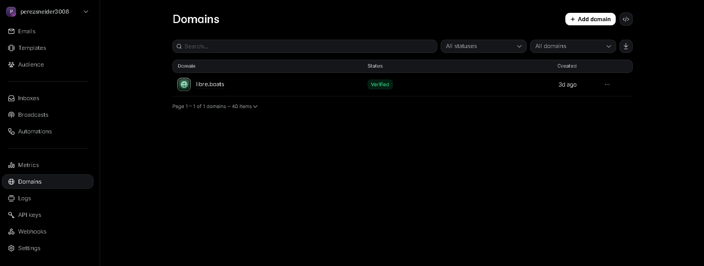
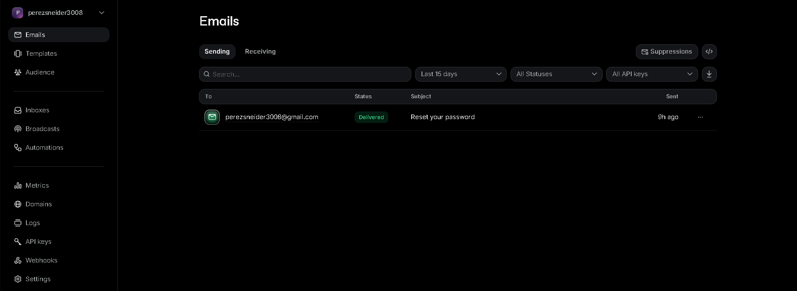

### Better Stack — monitoreo de disponibilidad

Un monitor HTTP consulta `https://libre.boats` cada 3 minutos. Muestra el estado (Up), el tiempo activo, los incidentes y la gráfica de tiempos de respuesta. No requiere código en la aplicación.

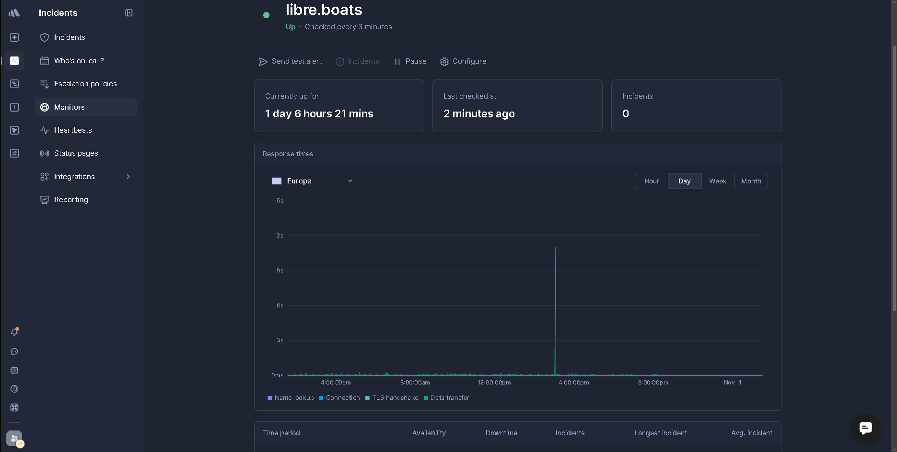

### Backblaze B2 — almacenamiento externo

Las portadas de los libros se guardan en un bucket **privado** de Backblaze B2 mediante su interfaz compatible con S3 (`league/flysystem-aws-s3-v3`). En `config/filesystems.php` el disco `s3` usa el endpoint de Backblaze y tiene `throw` activado, de modo que un fallo de subida se registra como error y llega a Sentry.

`BookController` guarda cada portada en la carpeta `covers` del disco por defecto y la elimina del bucket al reemplazarla o al borrar el libro. Como el bucket es privado, el modelo `Book` expone el atributo `cover_url`, que genera un **enlace temporal firmado** con vigencia de 6 horas. Con el disco local `public` devuelve la dirección normal, así que las vistas no cambian entre entornos.

Así, los archivos no dependen del disco del servidor y no se pierden al reiniciar o redesplegar.

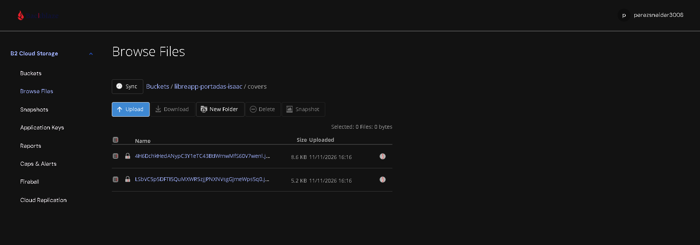
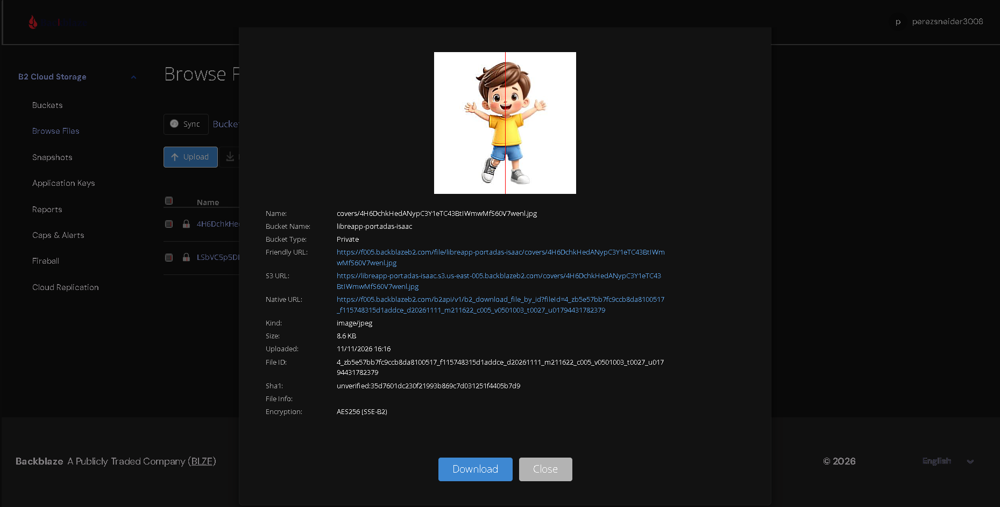

### Sentry — seguimiento de errores

Se usa `sentry/sentry-laravel`. El DSN se guarda en `SENTRY_LARAVEL_DSN` y el envío de datos personales está desactivado (`SENTRY_SEND_DEFAULT_PII=false`). En `bootstrap/app.php` se registra con `Integration::handles($exceptions)`. Para verificarlo, un administrador abre `/admin/sentry-test`, que lanza una excepción de prueba; Sentry la registra con la etiqueta `environment: production`.

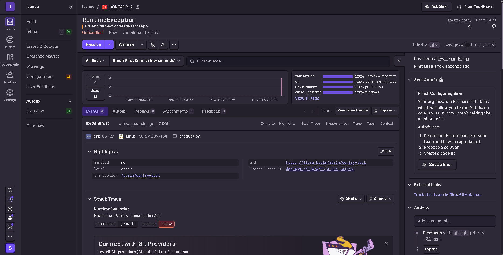

## Privacidad y eliminación de cuenta

Siguiendo la Ley 1581 de 2012 y sus decretos reglamentarios:

- **Política de tratamiento de datos** en `/privacidad`: identifica al responsable y su correo de contacto, los datos que se recolectan, las finalidades del tratamiento y el compromiso de no venderlos ni usarlos con fines comerciales.
- **Autorización del titular**: el registro exige marcar una casilla de autorización. Se guardan la fecha, la hora y la versión de la política aceptada, y el usuario puede consultarlas en Mi perfil.
- **Eliminación de cuenta** desde Mi perfil, con estas garantías:
  - Informa las consecuencias antes de ejecutar la acción.
  - Exige confirmar la contraseña y marcar una casilla de confirmación.
  - Anonimiza nombre y correo con datos genéricos y bloquea el acceso.
  - Rechaza las solicitudes pendientes.
  - Conserva el historial de préstamos sin datos personales.
  - No permite eliminar la cuenta si hay libros prestados sin devolver.

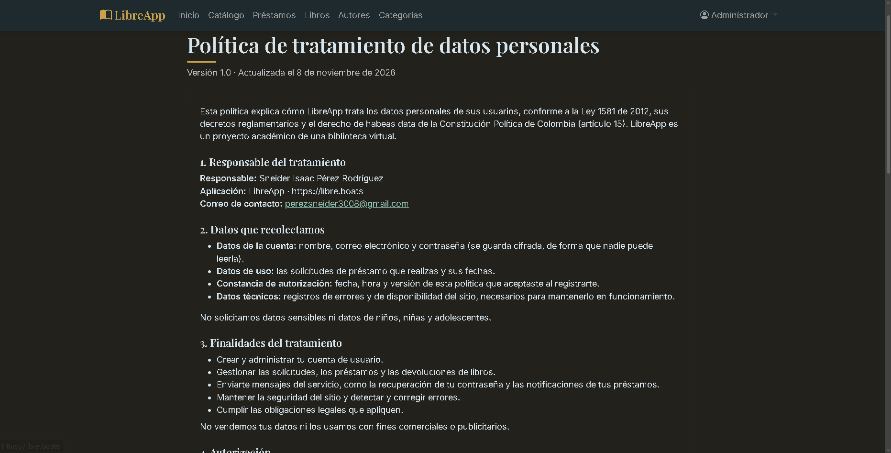
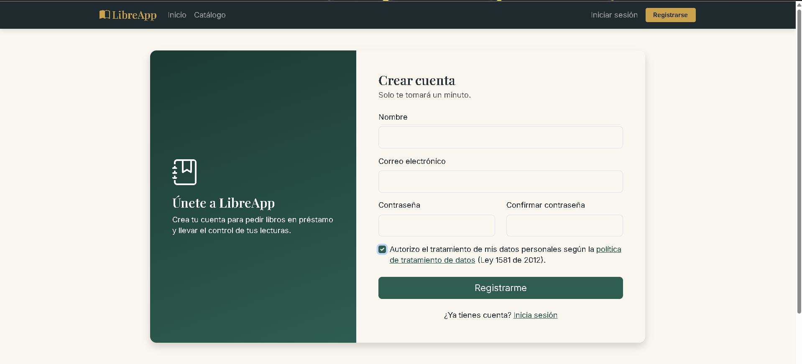
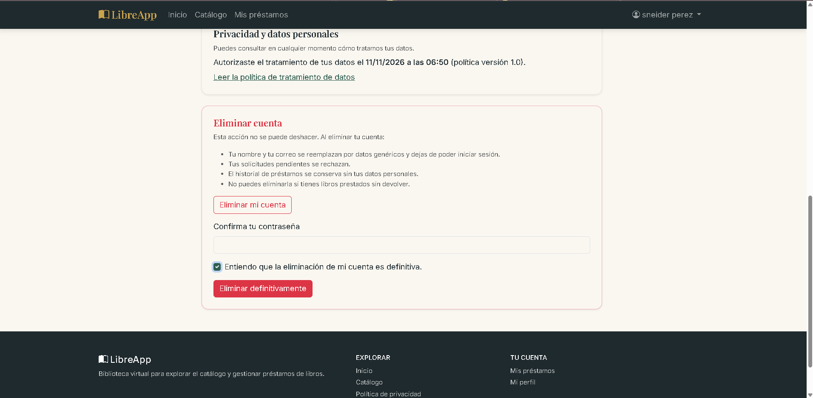

## Despliegue

La aplicación está desplegada en **Render** con un `Dockerfile` y una base de datos **PostgreSQL**. Al iniciar, el contenedor ejecuta `migrate` y `db:seed`. El dominio `libre.boats` se compró en Namecheap y apunta a Render con un registro A y un CNAME (`www` redirige al dominio principal); el certificado HTTPS lo emite Render automáticamente. Cada `git push` a la rama `main` genera un nuevo despliegue.

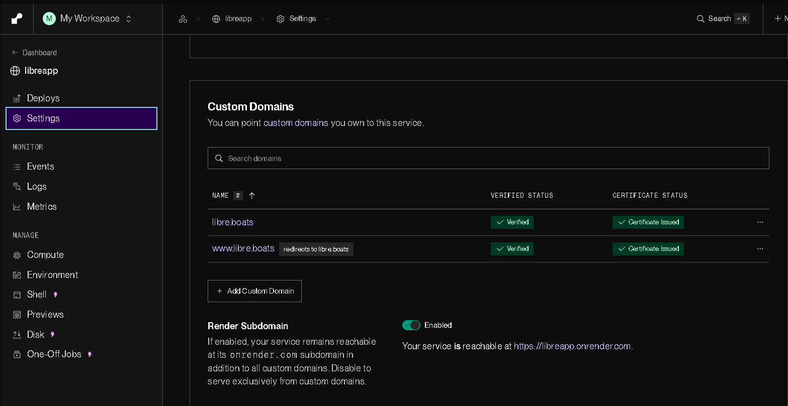

Limitaciones del plan gratuito de Render: la base de datos caduca a los 30 días y la primera visita después de un rato sin uso puede tardar cerca de un minuto. Las portadas **sí** se conservan, porque viven en Backblaze B2 y no en el disco del servidor.

## Capturas de la aplicación

| Inicio | Catálogo con portadas |
|---|---|
| 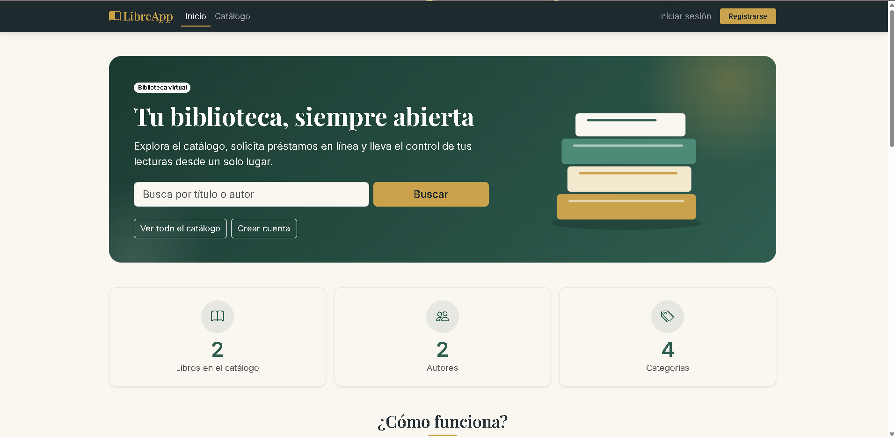 | 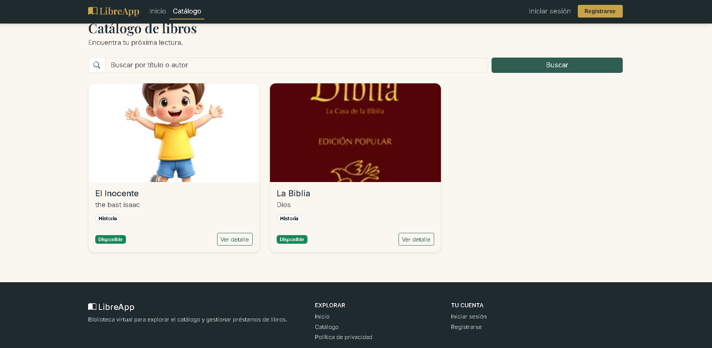 |
