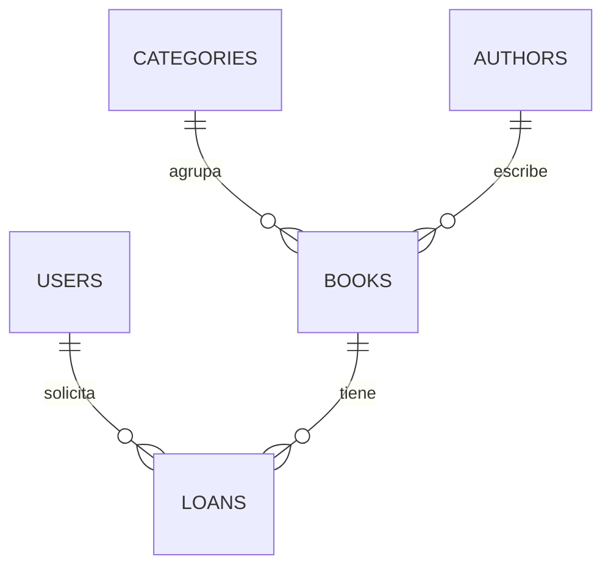

# LibreApp — Biblioteca virtual

**Estudiante:** Sneider Isaac Pérez Rodríguez
**Proyecto:** Proyecto práctico de Laravel
**Sitio en producción:** https://libre.boats

## Descripción

LibreApp es una aplicación web para gestionar el catálogo de una biblioteca y los préstamos de libros.

- Los **visitantes** consultan el catálogo, buscan por título o autor y ven la disponibilidad de cada libro.
- Los **lectores** se registran, solicitan préstamos y ven su historial con las fechas de vencimiento.
- El **administrador** gestiona libros, autores y categorías, aprueba o rechaza solicitudes, registra devoluciones y ve los préstamos vencidos.

## Tecnologías

| Capa | Tecnología |
|---|---|
| Backend | Laravel 13 y PHP 8.4 |
| Autenticación | Laravel Breeze |
| Interfaz | Blade y Bootstrap 5 |
| Base de datos | MySQL en local y PostgreSQL en producción |
| Despliegue | Docker en Render |
| Dominio | libre.boats (Namecheap) |

## Funcionalidades

### Zona pública
- Catálogo con búsqueda por título o autor y paginación.
- Detalle del libro con portada y copias disponibles.
- Registro e inicio de sesión.

### Zona del lector
- Solicitar un préstamo desde el detalle del libro.
- Ver mis préstamos con estado, fecha de préstamo, vencimiento y devolución.

### Zona del administrador
- CRUD de libros (con portada), autores y categorías.
- Aprobar o rechazar solicitudes y marcar devoluciones.
- Alerta y filtro de préstamos vencidos.

## Reglas de negocio

- No se puede solicitar un libro sin copias disponibles.
- Al aprobar un préstamo se descuenta una copia; al devolverlo, se suma.
- El préstamo vence a los **15 días** de ser aprobado.
- Cada lector puede tener como máximo **3 préstamos en curso** (pendientes y activos).
- No se puede eliminar una categoría, un autor o un libro con registros asociados.
- La aprobación y la devolución usan transacciones (`DB::transaction`) y bloqueo de fila (`lockForUpdate`).

## Modelo de datos



| Tabla | Campos principales | Relaciones |
|---|---|---|
| `users` | name, email, password, role (`admin` o `reader`), documento, telefono | Tiene muchos `loans` |
| `categories` | name, slug, description | Tiene muchos `books` |
| `authors` | name, nationality, bio | Tiene muchos `books` |
| `books` | title, isbn, description, year, copies_total, copies_available, cover_image, active | Pertenece a una `category` y a un `author`; tiene muchos `loans` |
| `loans` | status, loan_date, due_date, return_date, notes | Pertenece a un `book` y a un `user` |

Estados de un préstamo: `pending`, `active`, `returned`, `overdue` y `rejected`.

## Rutas principales

| Ruta | Acceso | Descripción |
|---|---|---|
| `/` | Público | Catálogo con búsqueda |
| `/libros/{id}` | Público | Detalle de un libro |
| `/login`, `/register` | Público | Autenticación |
| `/mis-prestamos` | Lector | Mis préstamos |
| `/admin/loans` | Administrador | Gestión de préstamos |
| `/admin/books` | Administrador | CRUD de libros |
| `/admin/authors` | Administrador | CRUD de autores |
| `/admin/categories` | Administrador | CRUD de categorías |

Las rutas `/admin` están protegidas con el middleware `admin`. Un usuario que no sea administrador recibe un error 403.

## Instalación en local

Requisitos: PHP 8.3 o superior, Composer, Node.js y MySQL.

```bash
git clone https://github.com/Srlsaac/Desempe-o-Libreria-.git libreapp
cd libreapp
composer install
```

Copia el archivo de entorno (en Windows: `copy .env.example .env`) y genera la clave:

```bash
cp .env.example .env
php artisan key:generate
```

Crea una base de datos vacía llamada `libreapp` y ajusta estas líneas en el `.env`:

```
DB_CONNECTION=mysql
DB_HOST=127.0.0.1
DB_PORT=3306
DB_DATABASE=libreapp
DB_USERNAME=root
DB_PASSWORD=
```

Después ejecuta:

```bash
php artisan migrate --seed
php artisan storage:link
npm install
npm run build
php artisan serve
```

Abre http://127.0.0.1:8000.

## Usuario administrador

El seeder crea este usuario:

| Correo | Contraseña |
|---|---|
| `admin@libreapp.com` | `password` |

Los lectores se registran desde `/register` y quedan con el rol `reader`.

## Despliegue

La aplicación está desplegada en **Render** con un `Dockerfile` y una base de datos **PostgreSQL**. Al iniciar, el contenedor ejecuta `migrate` y `db:seed`. El dominio `libre.boats` se compró en Namecheap y apunta a Render con un registro A y un CNAME; el certificado HTTPS lo emite Render automáticamente.

Variables de entorno necesarias en producción:

```
APP_NAME=LibreApp
APP_ENV=production
APP_KEY=<clave generada con php artisan key:generate --show>
APP_DEBUG=false
APP_LOCALE=es
APP_URL=https://libre.boats
LOG_CHANNEL=stderr
DB_CONNECTION=pgsql
DB_URL=<URL interna de la base de datos>
```

Limitaciones del plan gratuito: la base de datos caduca a los 30 días, las portadas subidas no se conservan al reiniciar el servicio y la primera visita después de un rato sin uso puede tardar cerca de un minuto.

## Capturas

| Pantalla | Captura |
|---|---|
| Catálogo público | ![Catálogo]
 |
| Gestión de préstamos (administrador) | ![Préstamos del administrador] 
|
